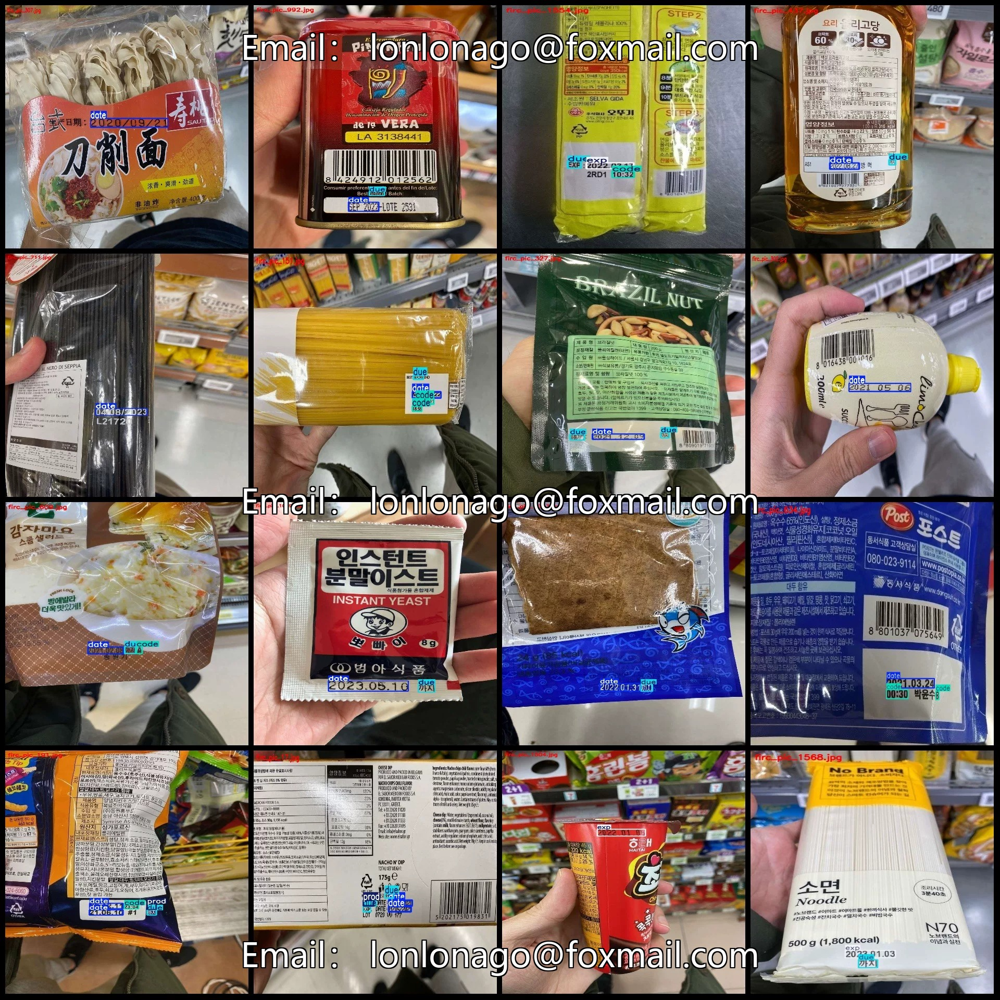
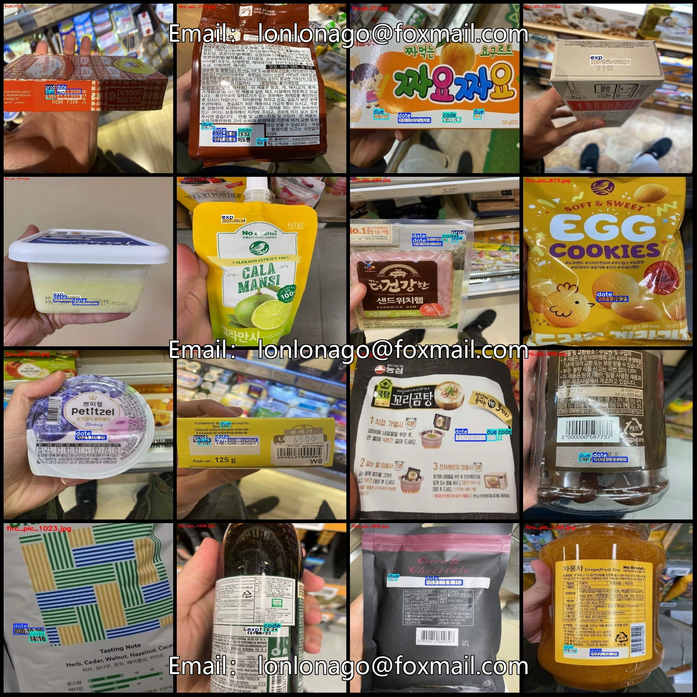
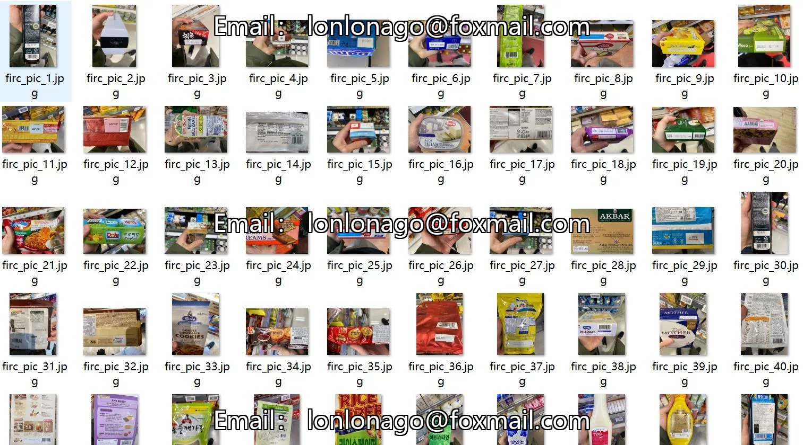
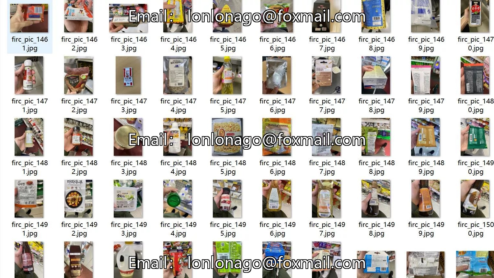
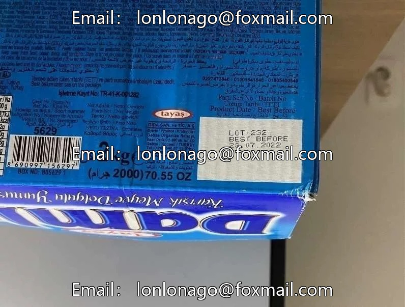
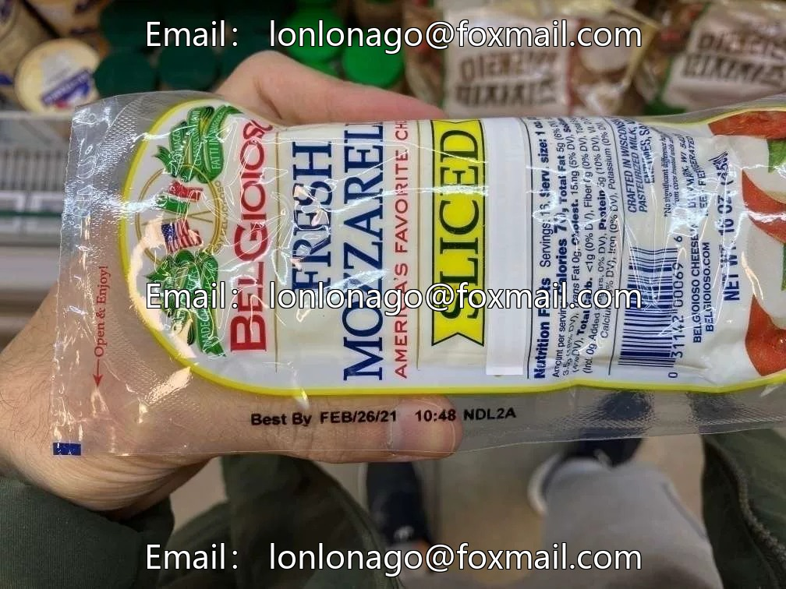
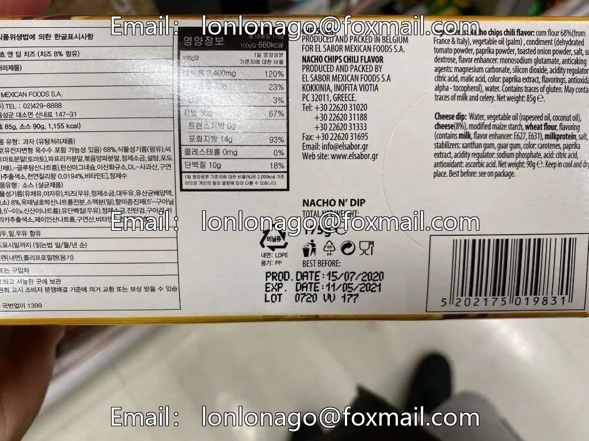

# Food Packaging Production Date and Shelf Life Detection Dataset VOC+YOLO format 1766

## Body

Food Packaging Production Date and Shelf Life Detection Dataset VOC+YOLO format: 1766 images in 5 categories
Tips: Due to the dataset's replicability, please confirm compliance with requirements before purchasing.
Note: The dataset does not include enhanced images; all images are Korean food packaging.
Dataset format: Pascal VOC format + YOLO format (txt file without split path, only containing jpg images along with corresponding VOC format xml files and yolo format txt files)
Number of images (number of jpg files): 1766
Number of annotations (number of xml files): 1766
Number of annotations (number of txt files): 1766
Number of annotation categories: 5

Annotation categories (Note that the order of labels in YOLO format does not correspond to this, but is based on the classes.txt file in the labels folder): ["code", "date", "due", "exp", "prod"]
Number of boxes and image counts per category:
- code (Product Code) - Boxes = 769, Image Counts = 651
- date (Date) - Boxes = 1312, Image Counts = 1166
- due (Use keyword before this date) - Boxes = 1353, Image Counts = 1088
- exp (Expiration date keyword) - Boxes = 664, Image Counts = 664

Prod (Production Date Keyword) Frames = 137, Image Count = 137
Total Frames: 4235
Image Resolution: Multi-resolution images such as 756x1008, 991x1322, etc.
Labeling Tool: labelImg
Labeling Rules: Draw a rectangle around the category.
Important Note: The dataset does not have separate training, validation, and test sets; you need to partition them yourself.
Special Remark: This dataset does not guarantee the accuracy of the trained models or weight files.

## Images

## Payment

Here is a pay link on Stripe ( https://buy.stripe.com/3cs8yP7sY87d0vu9AB ). Please contact me lonlonago@foxmail.com after funding $89, and I will send you a complete data files , thank you!

